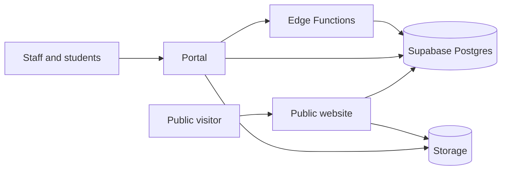
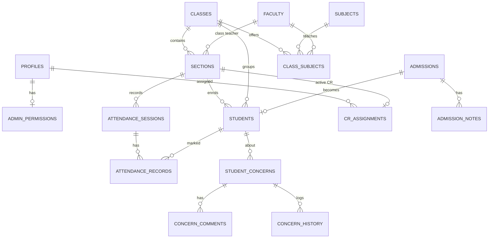
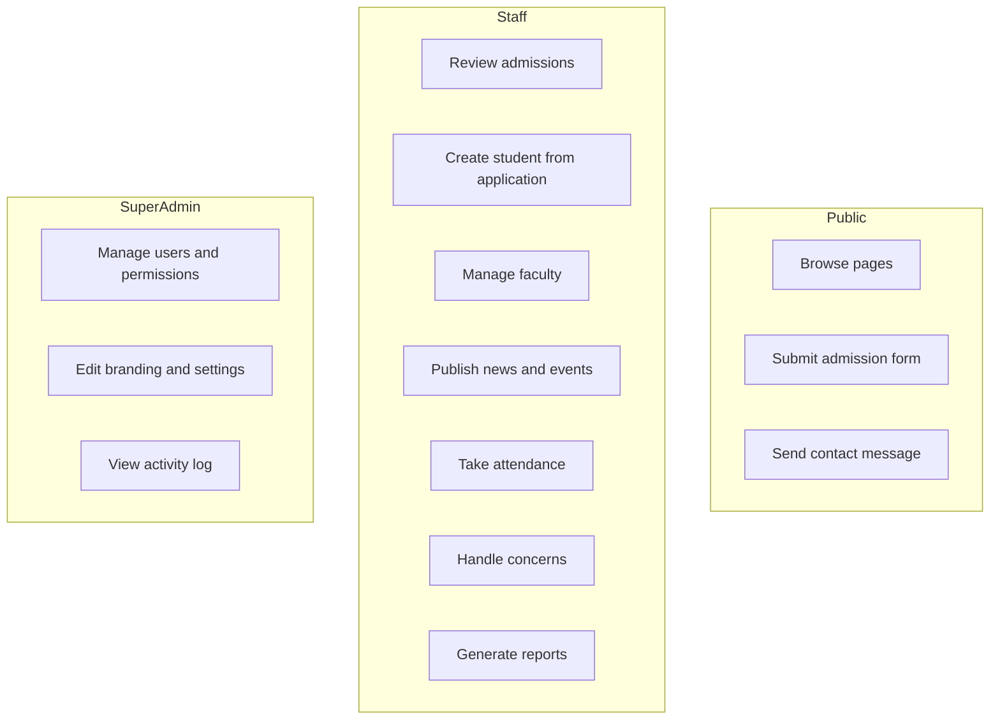
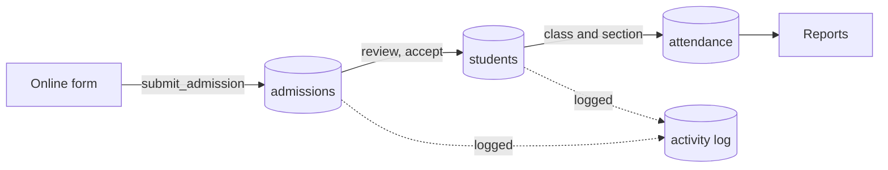

# Aspire Group of Colleges, Taunsa Sharif
## Integrated College Website and Academic Management System

---

## 1. Introduction
This project combines a public college website with a secure internal management portal. The portal grew out of an existing system, **Aspire CR Connect**, which handled class attendance, student concerns and reporting through Class Representatives (CRs). The website and the portal share one database and one visual identity, so information entered once appears wherever it is needed.

## 2. Problem Statement
- The college had no public web presence connected to its internal records.
- Admission applications had no structured channel and could not be tracked.
- Faculty, news and event information had to be maintained separately from academic records.

## 3. Existing System
Aspire CR Connect (React, TypeScript, Supabase) provided: role-based login, classes and sections, student records with CSV import, daily Present/Absent attendance with OCR scanning of paper sheets, a student concern lifecycle with comments and history, PDF/JPG/CSV reports, an accountability log, a Principal view, a Student Portal and announcements. It had no public site, admissions, faculty directory or content management.

## 4. Proposed System
All existing functionality is retained unchanged. Added:
1. A public website (Home, About, Academics, Faculty, Admissions, Student Life, News & Events, Contact).
2. An online admission form and an Admissions module in the portal, including creating a student record from an accepted application.
3. Faculty management, class teachers and subjects.
4. Website content management (news, events, programs, page text) and a Website & Branding settings page.
5. Admissions and Faculty reports, college-level dashboard figures.

## 5. Objectives
- Provide a trustworthy public face for the college.
- Connect admissions to student records without re-entering data.
- Keep public content manageable by authorised staff without a developer.
- Keep a record of who changed what.

## 6. Scope
**In scope:** the modules above. **Out of scope:** payroll, hostel, transport, library, inventory, biometric attendance, online fee payment, an examination engine, a parent mobile app, SMS/WhatsApp automation (see Future Enhancements).

## 7. User Roles
| Role | Purpose |
|---|---|
| Super Admin | Full access, including users, settings, branding and the activity log. |
| Administration | Access granted per account through permission flags (students, classes, attendance, concerns, reports, admissions, faculty, website content). |
| Principal | Read-only oversight; can raise concerns. |
| Teacher / CR | Manages attendance, students and concerns for their assigned section only. |
| Student | Views own attendance and raises personal queries. |
| Public visitor | Reads public pages; may submit the admission and contact forms. |

Access is enforced in the database (row-level security and function checks), not only in the interface.

## 8. Functional Requirements
- FR1 Public pages show only published and public data.
- FR2 Visitors can submit an admission application and receive an application number.
- FR3 Authorised staff can search, filter, review, annotate, accept or reject applications.
- FR4 An accepted application can be converted to a student record once; guardian, date of birth and other details carry over.
- FR5 Faculty can be added, edited and deactivated; public visibility is controlled per person; email and phone are never public.
- FR6 News, events, programs and page text can be edited and published from the portal.
- FR7 The Super Admin can change institution details, logos, colors and principal details.
- FR8 Teachers can record daily attendance; attendance reports are available.
- FR9 Concerns follow Submitted, Acknowledged, Under Review, In Progress, Resolved, Closed, Reopened with history.
- FR10 Reports (attendance, concerns, admissions, faculty) export as PDF, JPG or CSV where applicable.
- FR11 Important actions are recorded in an activity log.
- FR12 Staff with edit permission can draft descriptions with an AI writing assistant that uses only the facts they provide, flags unsupplied numbers and claims, and never saves anything without their review.

## 9. Non-Functional Requirements
- **Security:** authentication, role-based authorisation, input validation, database constraints, no administrative access for anonymous users.
- **Usability and accessibility:** labelled forms, keyboard navigation, visible focus, error messages not relying on colour alone, skip link.
- **Responsiveness:** desktop, tablet and mobile layouts.
- **Performance:** pages and portal modules are loaded on demand; lists are paginated; images are limited to 2 MB.
- **Maintainability:** content and branding are stored as data, not hard-coded.

## 10. System Architecture
Single-page application (React, TypeScript, Vite, Tailwind) hosted on Netlify, talking to one Supabase project (PostgreSQL, Auth, Storage, Edge Functions).

The public website reads only rows its policies expose. Staff pages call the same database with the signed-in user's identity, so row-level security decides what they can see and change.

## 11. Database Design
Core groups: **people** (profiles, admin_permissions, students, faculty), **academics** (classes, sections, subjects, class_subjects, cr_assignments), **attendance** (attendance_sessions, attendance_records), **concerns** (student_concerns, concern_comments, concern_history, concern_attachments, concern_notifications), **admissions** (admissions, admission_notes, contact_messages), **website** (site_settings, site_content, programs, news, events), **system** (system_settings, report_branding, announcements, admin_activity_logs, login_sessions, cr_warnings, cr_credentials, student_credentials).

### ER diagram (main relationships)

## 12. Use Cases

## 13. Data Flow (admission to attendance)

## 14. User Interface
*Screenshots to be added after the application is run in a browser. Not included because they have not been captured yet.*

## 15. Testing
**Performed (automated against the live database, with all test data rolled back):**
| Area | Result |
|---|---|
| Anonymous visitor can read only published and public data | Passed |
| Anonymous visitor blocked from students, admissions, messages, private settings and internal functions | Passed |
| Admission and contact forms accept valid input and return an application number | Passed |
| Admissions: view, status change, student creation by Super Admin, Administration with/without permission, Principal, CR | Passed |
| Duplicate roll number, second student from one application, status change after student created | Correctly refused |
| News, faculty, page text, site settings write access by role | Passed |
| Class teacher and subject management by role | Passed (one policy corrected during testing) |
| Audit entries written for each action | Passed |
| TypeScript type check and production build | Passed |

**Not yet performed:** manual browser testing of every screen, mobile layout checks, accessibility audit with assistive technology, load testing. These should be completed before release.

## 16. Limitations
- Passwords for CR and Student accounts are stored so the Super Admin can look them up (a retained original feature); this is a known security trade-off.
- CR and Student emails use the domain `aspiretaunsa.com`, which is configured in the edge functions and should be checked against the college's real domain.
- AI Assist for CSV import needs an external OpenAI key and is disabled until configured.
- The AI writing assistant needs an Google AI API key and sends the text typed into it (and related form fields) to that service; its drafts can still contain mistakes and must be reviewed.
- Public content is entered by staff; there are no automatic notifications.

## 17. Future Enhancements
Online fee payment, parent portal, mobile application, library, transport and hostel systems, payroll, advanced examination management, SMS/WhatsApp notifications, biometric attendance, advanced analytics. None of these are part of the current system.

## 18. Conclusion
The system joins a public website to the existing CR management platform through shared, permission-controlled data. A visitor can apply online; staff can review the application, create the student, assign a class, record attendance and report on it, with every important step logged.
